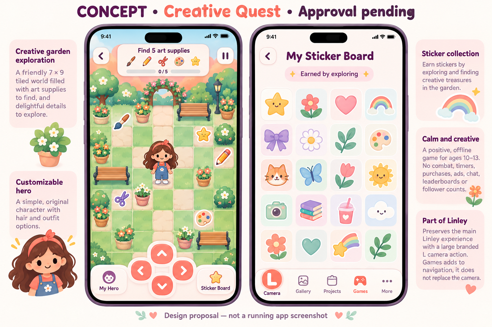

# Creative Quest — visual proposal

CONCEPT — approval pending. Generated with the built-in imagegen tool. This is not a screenshot or evidence of game execution. The user chose Creative Quest as the game scope; visual/family acceptance remains pending.

The first implemented game uses native SwiftUI shapes and SF Symbols: a simple cartoon hero, tiled garden, leaf obstacles and eight symbolic stickers. The concept proposes more elaborate illustrated plants/characters and more sticker designs than this first build. Those details and the concept's alternate navigation are proposals only. The actual parent app retains a centered L, adds Games next to Profile, and keeps Parent on the right. No exact real-person likeness is claimed.

## Final generation prompt

Use case: ui-mockup. Create a small polished concept board for Linley Creative Quest, an offline native iPhone/iPad mini game for a 10–13 year old creator. Clearly label at top 'CONCEPT • Creative Quest • Approval pending'. Show two flat portrait interface proposals side by side: left is a friendly top-down 7-column 9-row tiled creative garden, coral orange sky-blue mint palette, simple original rounded cartoon girl avatar with customizable hair and outfit (fictional, no real-person likeness), scattered paintbrush, pencil, scissors, palette and star collectibles, garden benches and pots as obstacles; HUD 'Find 5 art supplies', four arrow movement controls and 'My Hero' and 'Sticker Board'. Right shows a Pinterest-inspired sticker collection board with simple original stars, flowers, hearts and rainbow badges, labeled 'Earned by exploring'. Calm and creative, age-appropriate, no combat, no timer, no purchases, ads, chat, leaderboards, follower counts or Roblox branding. Bottom caption 'Design proposal — not a running app screenshot'. Native rounded UI in white/blush with plum text. Preserve a large branded L camera action in the parent app navigation; game adds a separate Games icon, not replaces the camera. This is a concept only; actual code will use simple native SwiftUI vector artwork.
