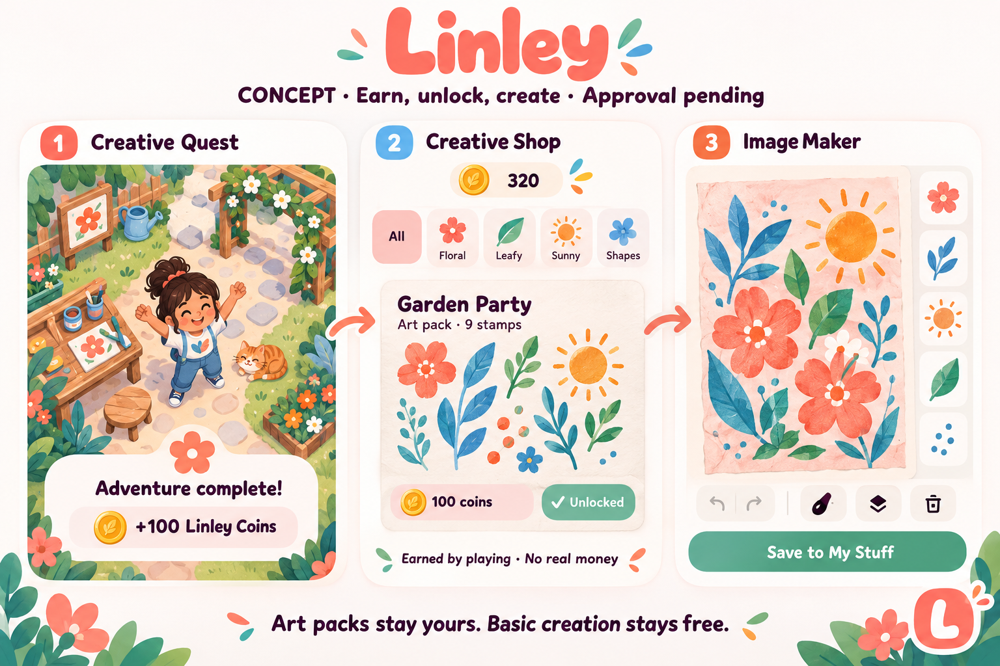

# Earn, unlock, create — visual review

CONCEPT — approval pending. Generated with the built-in imagegen tool on October 17, 2026. This is a proposed visual direction, not a screenshot or execution evidence.

Dad authorized the free earned-currency loop. The illustrated garden, watercolor artwork, tabs and advanced tools in this sample are visual proposals beyond the first native implementation. The first Garden Party pack has three SF Symbol stamps, not the nine shown by the generator. The illustrative 320 balance is not a real account value; the actual implementation awards 100 coins and prices packs in multiples of 100. Keep visual acceptance separate from feature validation. The source retains the branded L in parent navigation.

## Exact generation prompt

Use case: ui-mockup. Make a small polished landscape visual concept board for Linley, a free offline native creativity app for kids ages 10–13. Clearly label "CONCEPT · Earn, unlock, create · Approval pending". Three flat panels: 1 Creative Quest completed in a friendly top-down craft garden with simple fictional cartoon girl, art supplies, caption "Adventure complete" and "+100 Linley Coins". 2 Creative Shop with a coin balance and original floral/leaf/sun art stamps, art pack "Garden Party", "100 coins", "Unlocked", clear caption "Earned by playing · No real money". 3 Image Maker showing an original collage of coral flowers, blue leaves and orange sun on blush paper, tools for reusable stamps, "Save to My Stuff". Show subtle connecting arrows between panels to communicate the play-and-create loop. Coral, sky blue, orange, mint, pale blush and white with legible dark plum rounded typography, generous whitespace. No prices in dollars, buy coins, checkout, ads, daily streaks, loot boxes, social interactions, Roblox branding, child photos or paid AI claims. Bottom caption "Art packs stay yours. Basic creation stays free." This is a proposed visual direction, not running-app evidence. Keep a distinctive large coral L button as a small footer motif rather than an ordinary camera icon.
